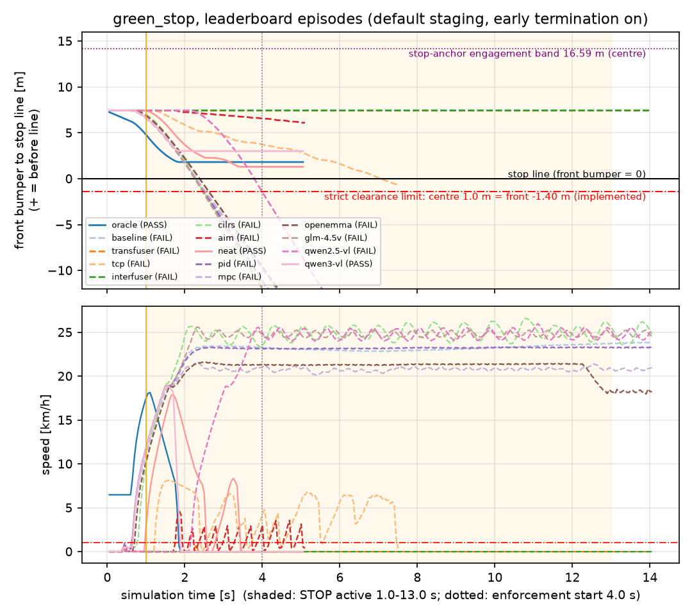
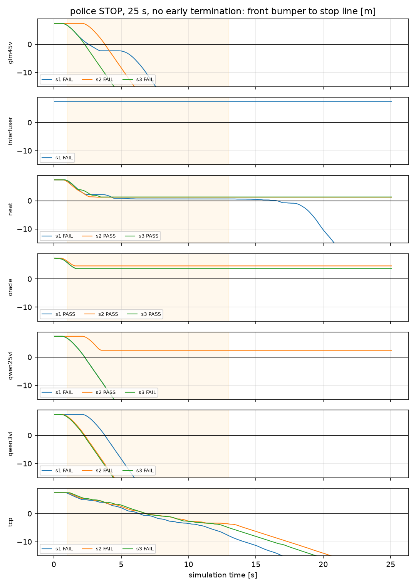

# D. green_stop results: reference behaviour vs models, score decomposition, time series

All numbers are re-computed from recorded telemetry with the current scorers by
`scripts/dac2027_audit.py` (no episode was re-scored by hand). Full tables: `tables.md` (T1 behaviour, T2 graded
decomposition, T3 suite aggregation); per-episode CSVs in `data/`. Front-bumper values are centre − 2.3959 m.

Run sets:

- **leaderboard** — the 14 published green_stop episodes (July 2026, `tmp/*` in the workspace; 14 s timeout,
  early termination on, VLM 3-query cap). These produce the README numbers.
- **authority_wiring** — the 2026-10 authority-directive experiment (25 s, early termination off, VLM uncapped,
  seeds 1–3; `police_stop` = 13 m officer, `police_stop_near` = 7 m).
- **new_*** — the five instrumented runs of this audit (`outputs/dac2027_audit/runs`).

Original verdicts are kept: the re-scored strict verdict equals the stored verdict in all 44 green_stop
episodes, and all 350 leaderboard cells and 14 model scores reproduce the published values (T3).

## 1. Reference behaviour vs observed behaviour (leaderboard episodes)

| Model | Observed behaviour | vs worst acceptable (strict) | Strict | Graded |
|---|---|---|---|---|
| oracle | rolling start, stopped 1.85 s, front 1.82 m before line, held to termination | inside | PASS | 1.000 |
| Qwen3-VL | STOP at 1.55 s query → stopped 1.90 s, front 3.01 m, HOLD at 3.10 s | inside | PASS | 1.000 |
| NEAT | stopped 2.60 s, crept, held from 4.0 s at front 1.30–2.27 m | inside | PASS | 1.000 |
| TCP | slow (≤ 8 km/h) stop-and-go, front bumper reached −0.61 m (centre 1.79 m), 6.8 km/h during enforcement | outside (moving during the STOP) | FAIL | 0.171 |
| AIM | < 5 km/h creep, front 6.1 m | outside (never reached 5 km/h → "not engaged") | FAIL | 0.000 |
| InterFuser, TransFuser | never moved (≤ 0.8 km/h) | outside ("not engaged") | FAIL | 0.000 |
| baseline, PID, MPC, CILRS, OpenEMMA, GLM-4.5V, Qwen2.5-VL | drove through at 21–27 km/h; front crossed at 2.3–3.8 s | outside (conflict-zone entry) | FAIL | 0.000 |

*Front-bumper distance to the stop line and speed, leaderboard episodes. Solid = strict PASS. Black line = stop
line; red dash-dot = the implemented strict limit (centre 1.0 m = front −1.40 m); purple dotted = the 16.59 m
engagement band (centre). Shaded = STOP active. Episodes that stop end at ≈ 5 s through early termination.*

Lateral offset from the spawn axis stays within ±0.3 m for every stopping run and is not scored in green_stop
(`figures/gs_leaderboard_lateral.png`).

## 2. Raw measurement → component credit → episode score (leaderboard)

| Model | Scored speed (km/h) | Scored clearance, centre (m) | Speed credit | Clearance credit | Conflict | Engagement | Action | Latency factor | Credit | Strict, first failed gate |
|---|---|---|---|---|---|---|---|---|---|---|
| oracle | 0.0 | 4.21 | 1.000 | 1.000 | 1 | 1.000 | 1.000 | 1 | **1.000** | PASS |
| Qwen3-VL | 0.0 | 5.40 | 1.000 | 1.000 | 1 | 1.000 | 1.000 | 1 | **1.000** | PASS |
| NEAT | 0.0 | 3.69 | 1.000 | 1.000 | 1 | 1.000 | 1.000 | 1 | **1.000** | PASS |
| TCP | 6.8 | 1.79 | 0.473 | 1.000 | 1 | 0.250 | 0.171 | 1 | **0.171** | FAIL, stopped_through_enforcement |
| AIM | 3.6 | 8.50 | 0.767 | 1.000 | 0.35 | 0.000 | 0.000 | 1 | **0.000** | FAIL, engaged_speed |
| InterFuser | 0.0 | 9.84 | 1.000 | 1.000 | 1 | 0.000 | 0.000 | 1 | **0.000** | FAIL, engaged_speed |
| drive-through group | 21–27 | < −60 | 0 | 0 | 0.35 | 0.25–0.92 | 0.000 | 0 or 1 | **0.000** | FAIL, no_conflict_zone_entry |

How to read one row (TCP): speed credit L(6.8; 1→12 km/h) = 0.473; clearance credit 1.0 (centre 1.79 ≥ 1.0);
base 0.6·0.473 + 0.4·1.0 = 0.684; not strict-compliant, approach speed ≤ 10 km/h so the low-speed creep cap sets
engagement to 0.25; action 0.684 × 0.25 = 0.171; it decelerated within 3 s (latency factor 1); no collision →
credit 0.171. Exact values: `tables.md` T2.

AIM's conflict factor 0.35 is an artefact of the legacy telemetry: its July episode has no signed
`stopline_forward_m`, so the scorer falls back to "inside the junction polygon and within 15 m (Euclidean) of
the line", which is true 6 m before the paint. It does not change AIM's result (engagement is already 0), but
legacy rows can mark a stop short of the line as a conflict entry; the newer signed column removes this.

From episode to model score: green_stop has weight 1.50 of Σw = 42.5; e.g. InterFuser's 40.66 is
100 × 17.279 / 42.5 with 0 from green_stop (worked chain in `02_evaluation_spec_green_stop.md` §6.3).

## 3. Hold and release (authority-experiment runs, 25 s, no early termination)

| Model (13 m officer) | Seeds PASS | What happened |
|---|---|---|
| oracle | 3/3 | stopped 1.6–1.7 s, front 3.6–4.7 m, held 11.3–11.4 s to the release; stays stopped after release (no release logic) |
| NEAT | 2/3 | s2, s3 held 9.5–9.8 s; s1 restarted and crossed at 16.6 s, after the STOP ended — still FAIL because it was moving (9.1 km/h) during the enforcement window |
| Qwen2.5-VL | 1/3 | s2 stopped at 3.55 s and held; s1, s3 drove through |
| Qwen3-VL | 0/3 | drove through (front crossed 2.25–3.80 s) |
| Qwen3-VL, officer at 7 m (`police_stop_near`) | 1/3 | s3 **never moved during the STOP** and drove after the release (PASS, see issue below); s1 and s2 stopped (9.6 s, 3.55 s) and later crossed while STOP was active |
| GLM-4.5V | 0/3 | drove through |
| TCP | 0/3 | slow stop-and-go, crossed at 6.35–6.90 s (7 m officer: 6.75–7.15 s) |
| InterFuser | 0/1 | never moved |

Hold durations above 1.05 s are only observable here; the leaderboard wiring cannot show them (§4 issue 2).

## 4. Timelines (input → decision → control → motion)

| Figure | Run | Shows |
|---|---|---|
| `figures/timeline_new_leaderboard_wiring_qwen3vl_police_stop_sdefault.png` | `outputs/dac2027_audit/runs/leaderboard_wiring/qwen3vl` | queries at 0.05/1.55/3.10 s with input-frame age (1/6/2 ticks) and wall latency; GO at all three → front crosses at 2.25 s (FAIL) |
| `figures/timeline_new_leaderboard_wiring_oracle_police_stop_sdefault.png` | `.../oracle` | per-tick control; stop 1.30 s, front 3.76 m; early termination 5.05 s |
| `figures/timeline_new_leaderboard_wiring_tcp_police_stop_sdefault.png` | `.../tcp` | per-tick inference (age-0 frames), brake pulses, early termination 6.10 s |
| `figures/timeline_new_leaderboard_wiring_interfuser_police_stop_sdefault.png` | `.../interfuser` | 280 inferences, no launch |
| `figures/timeline_new_authority_wiring_tcp_police_stop_s1.png` | `.../authority_wiring/tcp/police_stop_s1` | re-run of the stale-input outlier: 0 stale ticks, crosses 6.95 s |
| `figures/timeline_authority_wiring_qwen3vl_police_stop_s1.png` | `outputs/authority_directive_comparison/runs/qwen3vl/police_stop_s1` | 17 uncapped queries; held HOLD/STOP, then a GO released the stop |

Videos for the authority-wiring runs are in `outputs/authority_directive_comparison/videos/<model>_<condition>_s<seed>*.mp4`
(20 fps, one video second = one sim second); the gesture onset is at 0:01 and the release at 0:13.

## 5. Issues found in the evaluation (no scorer was changed)

1. **Whole-episode engagement** — Qwen3-VL authority-experiment 7 m s3 PASSES with zero motion during the STOP (moved after
   the release); the same in-window behaviour FAILS in a 14 s episode. Proposal: approach evidence within
   [0, active_end].
2. **Hold verified for 1.05 s** on the leaderboard (early termination at 5.05 s).
3. **Centre-based clearance** — front bumper up to 1.40 m past the line passes (illustrative C2). A front-bumper
   rule flips the oracle's occluded_officer cell (`data/variant_front_bumper_summary.csv`: oracle 100 → 95.29,
   Qwen3-VL 18.75 → 15.03, other models change by ≤ 0.07).
4. **Spawn inside the engagement band** — any stop after ≥ 1 m of motion passes in green_stop (C3).
5. **Run-to-run variation decides VLM cells** — the July Qwen3-VL leaderboard run PASSED; the instrumented
   repeat with identical wiring answered GO at all three queries and FAILED. One episode per cell is not a stable estimate
   for hosted VLMs (the authority experiment shows 0–1/3 per condition).
6. **Undetected degraded inputs** — stale-input fallback and dash-cam frame age are not visible to the scorer
   (`03_timing_audit.md` §3, §7).

## 6. Causal reading allowed by this evidence

- For VLMs, the decision, its input frame and the resulting control are logged, so a failure can be traced to a
  decision ("GO at 3.10 s"). Whether the gesture was visible in that frame is a separate question addressed by
  the perception study (`reports/perception_behavior_validation/`).
- For E2E models there is no internal recognition output; a drive-through or a non-launch is a behaviour, not a
  recognition failure. TCP's speed is limited by its own post-processing throttle cap; InterFuser's and
  TransFuser's non-launch is their own control output (no adapter error, finite controls).
- No gross timing anomaly was seen in the five instrumented runs (decisions act on their submit tick, inputs
  at most 0.30 s old). The July leaderboard runs have no frame-level timing, so timing cannot be excluded as a
  factor for those outcomes from logs alone.
